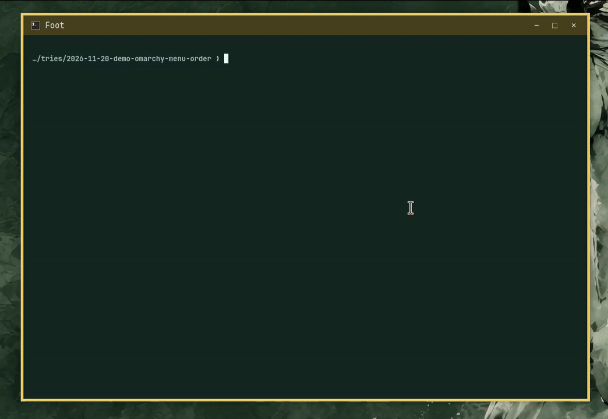

# My Claude Skills as a DevOps Engineer

Hi, I'm Puru Tuladhar, a DevOps engineer. This repo is where I share the Claude skills I use in my daily work.

## What is a Claude skill?

A skill is a small instruction file (`SKILL.md`) that teaches Claude how to do one job in a set way.

You write the instructions once and then call the skill by name whenever you need it, instead of explaining what you want every time.

## Why does a DevOps engineer need this?

DevOps work means DNS, CI/CD pipelines, Kubernetes, cloud accounts, certificates, on-call and a lot more. Every day there is something new to learn, debug or explain to a teammate.

Claude helps a lot with this, but it often gives you a long wall of text all at once. Skills fix that. They make Claude work the way I like to work, so I get answers I can actually follow and act on.

## Skills

### step-by-step

Explains any topic one small step at a time. Each step is a single, simple sentence, and Claude waits until you reply **"understood"** before it moves on.

I use it when I need to really understand something before I touch production, for example:

```
/step-by-step how a custom domain on Vercel points to our app
/step-by-step why the TLS certificate renewal is failing
/step-by-step how this GitHub Actions workflow deploys to EKS
```

At the end, it gives you a short checklist of what is left to do and who should do it.

[See the skill →](skills/step-by-step/SKILL.md)

### omarchy-menu-order

Reorders the menus on [Omarchy](https://omarchy.org/), for example moving Lock to the top of the System menu (Super + Esc). Just say what you want:

```
/omarchy-menu-order lock to the top
/omarchy-menu-order move logout below reboot
/omarchy-menu-order reset
```



Claude reads the menu on your machine, works out the new order and applies it. The change shows up straight away, with no restart. Only the user's own menu file is changed, inside clearly marked lines, and a backup is kept. Omarchy's own files are never edited.

Omarchy updates can change menu items, and a hand-made copy would quietly go stale. To prevent that, the skill installs a small update hook that rebuilds your order from the new menu after every `omarchy update`. `reset` removes the reorder and the hook.

The skill only reorders existing items. If a request needs anything riskier, like changing what an item runs or editing Omarchy's system files, Claude explains why and doesn't do it.

Needs `python3`.

[See the skill →](skills/omarchy-menu-order/SKILL.md)

## How to use a skill

1. Copy the skill folder into your Claude skills folder:

   ```bash
   cp -r skills/step-by-step ~/.claude/skills/
   # or: cp -r skills/omarchy-menu-order ~/.claude/skills/
   ```

2. Open Claude Code and type the skill name, for example `/step-by-step` followed by your topic.

## More skills coming

This is just the start. I'll keep adding skills that help with everyday DevOps work, such as debugging, incident notes and infrastructure reviews. Each new skill will be listed in this README.

## Free to use

Everything here is free to use, copy and change for your own work (MIT License). If a skill helps you, or you have an idea for a new one, feel free to open an issue or a pull request.
